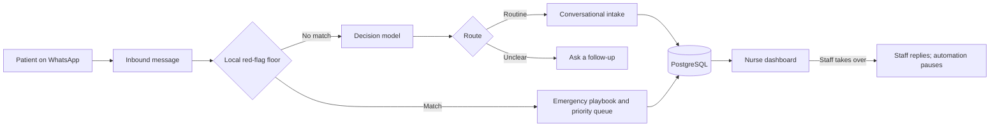

<div align="center">

# Qure!

**A WhatsApp triage and intake assistant for Indonesian community health centers.**

Qure! helps patients describe their symptoms, routes potential emergencies for
priority review, and gives clinic staff a live view of the waiting queue.


[](https://github.com/kakaparubak/qure-hackathon/actions/workflows/ci.yml)

[Quick start](#quick-start) · [How it works](#how-it-works) · [Safety](#safety-and-limitations) · [Deployment](deploy/README.md)

</div>

> [!WARNING]
> **Experimental hackathon project.** Qure! is not a medical device and is not
> validated for clinical use. Do not rely on it for diagnosis, treatment, or
> emergency response. Use synthetic data for development and demonstrations.
> The Baileys WhatsApp integration is unofficial and intended for demos.

## Why Qure!

Patients often arrive at a community health center without a structured account
of what is wrong. Qure! collects an initial history over WhatsApp, identifies
messages that need urgent human review, and gives staff a shared queue and
conversation view.

This project was built for the Joints X UGM hackathon, healthcare subtheme. Its
design favors escalation when uncertain: automation can raise urgency, but it
cannot remove an emergency flag or replace a clinician.

## Features

- **Bahasa Indonesia WhatsApp intake** with context-aware symptom and history
  collection.
- **Escalate-only triage** with a local red-flag rules layer ahead of model
  assessment.
- **Emergency support** with fixed first-aid guidance and direct emergency
  service instructions.
- **Staff dashboard** for the live queue, patient conversations, and staff
  takeover, with automation paused during staff care.
- **Persistent visits and queue tickets** backed by PostgreSQL and Drizzle.
- **Waiting-room operations** including scheduled check-ins, surge notices, and
  opt-in callback slots.
- **FHIR R4 visit export** for structured interoperability experiments.
- **Private VPS deployment** using Docker Compose and SSH tunneling.

## How it works



The red-flag floor is deterministic, local, and runs before model assessment.
When it matches, the triage model is skipped. Otherwise, the decision model
assesses urgency and intent, then the backend chooses the next step. Intake
models can extract only patient-supported facts and write conversational
replies; the backend controls stored fields, completeness, queue placement, and
escalation.

When a patient asks what to do during routine intake, the reply model may offer
brief, general self-care guidance and empathetic support. It must not diagnose,
recommend medication or doses, or tell someone that they are safe. Intake reply
generation tries the configured models up to three times (15 seconds for the
first attempt, then 10 seconds for each retry) before using a fixed question.

Emergency messages receive a deterministic playbook and emergency-service
instructions. Later emergency replies select from a bounded support catalog;
they do not generate free-form treatment. A supportive response may acknowledge
fear without claiming that the patient is safe. The first emergency reply does
not wait for an LLM. Follow-up guidance selection tries up to three provider
requests before using the local catalog fallback.

## Quick start

### Requirements

- [Bun](https://bun.sh/) 1.4 or newer
- PostgreSQL, such as a Supabase project
- An OpenRouter API key and configured triage model IDs/cutoffs

### Run locally

```bash
git clone https://github.com/kakaparubak/qure-hackathon.git
cd qure-hackathon
bun install --frozen-lockfile
cp .env.example .env
```

Edit `.env` and set the required database, OpenRouter, model, dashboard login,
and webhook token values. Keep secrets out of source control. Then apply the
database migrations and start the API:

```bash
bun run --cwd packages/db migrate
bun run dev
```

Open the dashboard at [http://localhost:3000/dashboard/](http://localhost:3000/dashboard/).
The API also exposes `POST /webhook/inbound` for local integration testing; the
route requires the configured bearer token. `GET /health` checks liveness and
`GET /ready` checks that the application is ready to serve traffic.

To link a WhatsApp number, configure `WA_ENABLED=true` and follow the pairing
instructions printed by the API. Use a spare demo number with the unofficial
Baileys integration. For a private VPS setup, see the [deployment guide](deploy/README.md).

## Configuration

The complete variable list and comments are in [`.env.example`](.env.example).
Key settings include:

| Variable | Purpose |
| --- | --- |
| `DATABASE_URL` | PostgreSQL connection used by the API |
| `OPENROUTER_ENDPOINT`, `OPENROUTER_API_KEY` | Triage model API endpoint and credential |
| `MODEL_PRIMARY_ID`, `MODEL_FALLBACK_ID` | Ordered triage model slots |
| `RED_FLAG_CUTOFF_PRIMARY`, `RED_FLAG_CUTOFF_FALLBACK` | Per-model escalation thresholds |
| `DASHBOARD_USERNAME`, `DASHBOARD_PASSWORD` | Dashboard login; use a unique password |
| `INBOUND_WEBHOOK_TOKEN` | Bearer token for the inbound HTTP adapter |
| `WA_ENABLED` | Enable WhatsApp pairing, or leave `false` for webhook-only mode |
| `ZAI_API_KEY` | Optional primary conversational intake provider |
| `LLM_ENDPOINT`, `LLM_MODEL_ID` | Conversational intake fallback provider |

Do not copy secrets into issues, screenshots, logs, or commits. Never use real
patient information for a demo or test.

## Development

```bash
bun test                   # API, core, and database tests
bun run test:dashboard    # Dashboard tests
bun run typecheck         # Strict TypeScript checks across the monorepo
bun run build             # Build the dashboard
```

Tests use fakes and isolated PGlite databases; they do not require external
model credentials or a configured database. SSE and container-readiness
integration tests bind local ports, so run them in an environment that permits
local listeners. The GitHub Actions workflow runs typecheck and tests on pushes
and pull requests to `main`.

### Project layout

| Path | Responsibility |
| --- | --- |
| `apps/api` | Fastify server, webhook ingestion, dashboard API, and wiring |
| `apps/dashboard` | React and Vite staff dashboard |
| `packages/core` | Triage, red-flag rules, intake, emergency support, and FHIR mapping |
| `packages/db` | PostgreSQL schema, migrations, and persistent pipeline store |
| `deploy` | Docker/VPS deployment instructions |
| `docs` | Demo artifacts and project documentation |

## Safety and limitations

- **Escalation is one-way.** No model or later message can clear an existing
  emergency flag. Explicit requests for staff are handed off.
- **The red-flag floor does not call an LLM.** A match short-circuits model
  triage and selects emergency handling.
- **Models do not control clinical state.** Backend rules decide escalation,
  intake completeness, and queue placement. Emergency response text comes from
  fixed, reviewable playbooks and a bounded catalog.
- **No dispatch is guaranteed.** Queue placement and dashboard alerts do not
  prove that a staff member saw the message or that emergency services were
  contacted.
- **Guidance is limited.** General self-care text is not a diagnosis or
  treatment plan. Medication selection and dosing are not provided.
- **Clinical review is still needed.** Emergency playbooks and triage behavior
  require review by qualified local clinicians before any real-world use.
- **WhatsApp transport is unofficial.** Baileys can change or be restricted by
  WhatsApp; use a dedicated demo number.

See [emergency support scope and sources](packages/core/src/emergency/README.md)
for the current first-aid catalog and its limitations.

## Contributing

Issues and pull requests are welcome. Before opening a pull request, run the
tests and typecheck above. Changes to red-flag patterns, escalation behavior, or
emergency guidance should include focused tests and supporting clinical
references. Do not include real patient data or credentials in contributions.

## License

No license has been added yet. Until the maintainers choose and add one, this
repository does not grant permission to reuse or redistribute its code.
